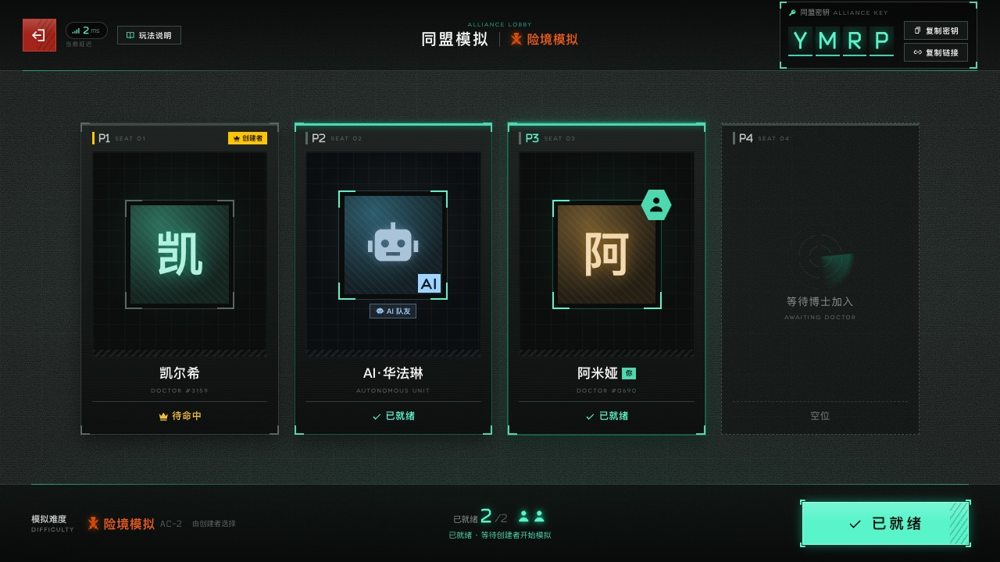
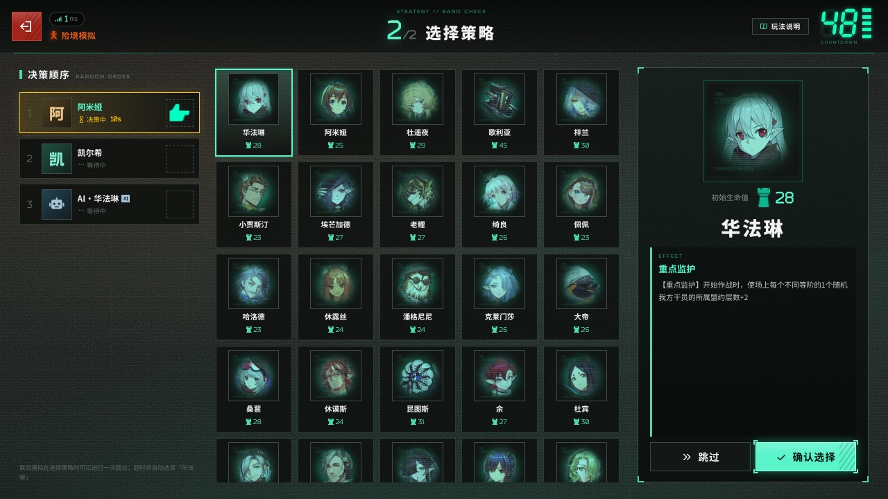
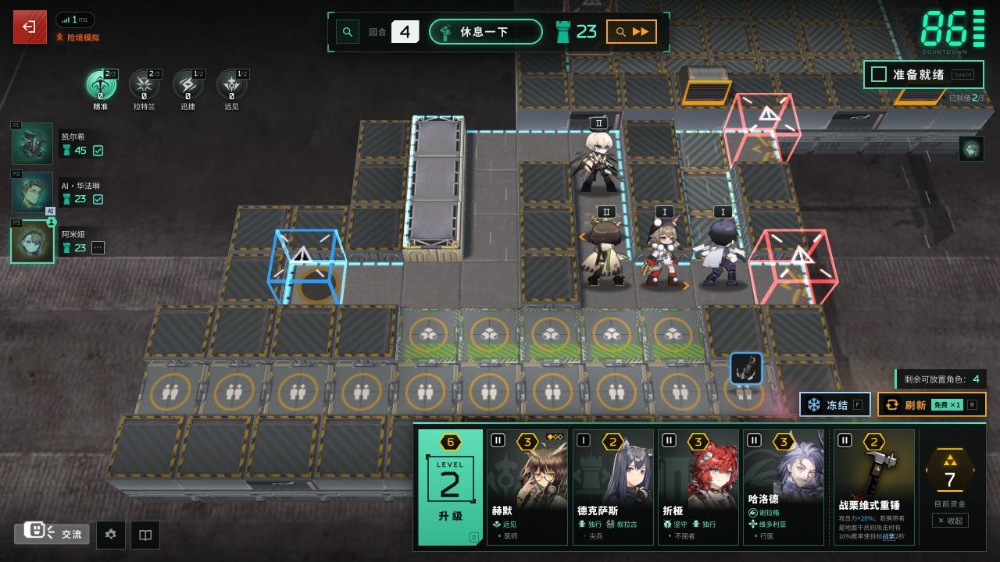
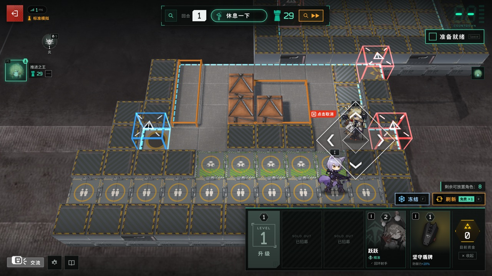
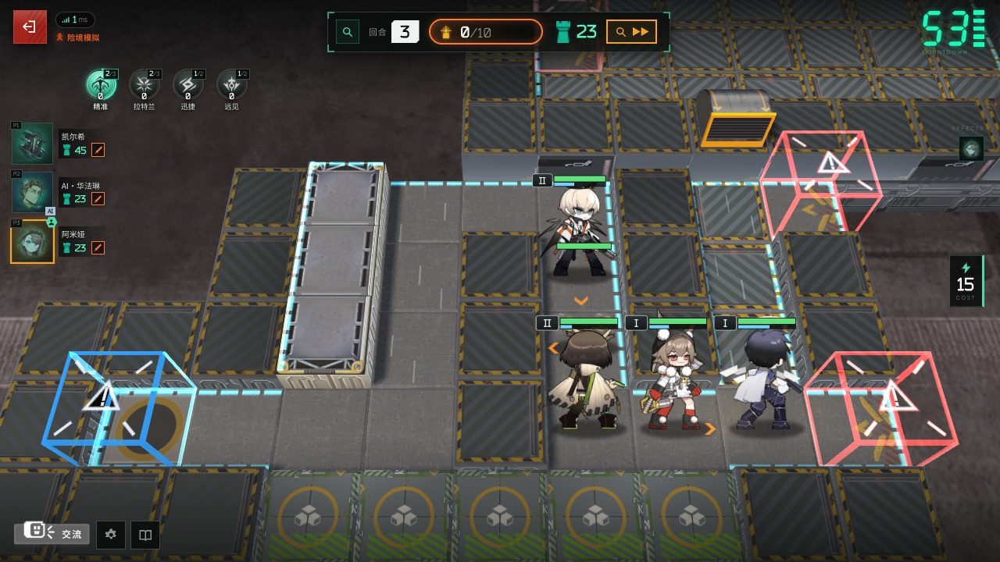
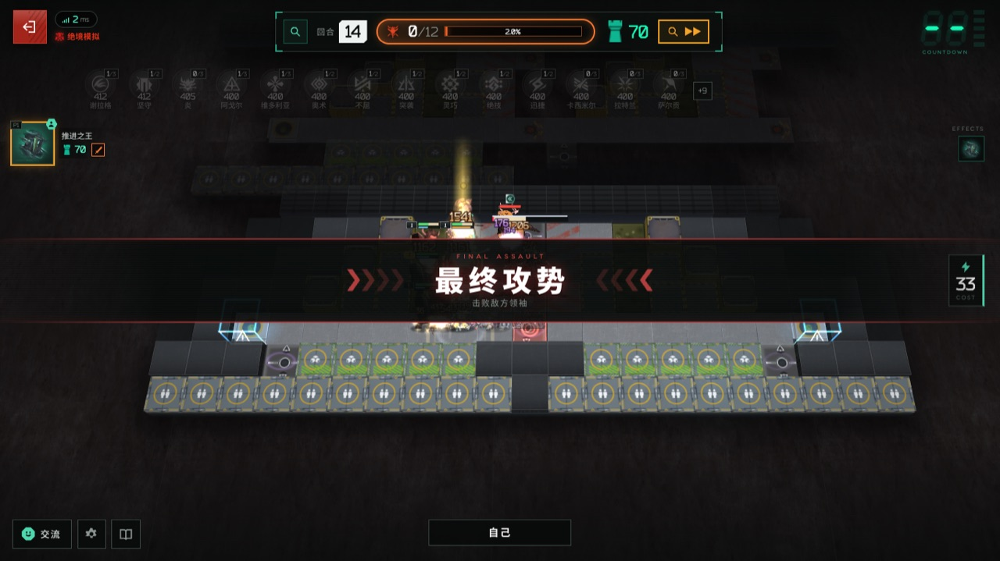

# 卫戍协议：盟约 · Stronghold Protocol: Covenant


《明日方舟》「卫戍协议：盟约」玩法的**非官方同人复刻与扩展版本**。结合自走棋、塔防和盟约成长，支持单人模拟与 1–4 人合作；本分支增加账号与排位、原生客户端、持久资源包，以及可按局启用的内容拓展。

基于 [sganggs/Stronghold-Protocol](https://github.com/sganggs/Stronghold-Protocol) 开发，保留上游许可证、版权说明与第三方组件声明。

> **游玩入口：Android App / Windows 客户端。** 手机和电脑浏览器用于登录、修改密码、管理账号及赛季、下载客户端；当前联机版不提供浏览器直接游玩。
>
> **这是源码仓库。** 游戏美术、音频、字体、固定资源 ZIP、已编译安装包、依赖目录与私有账号数据不随 Git 提交。克隆后仍需准备依赖、资源和客户端；GitHub Pages 不能直接运行这个 Node.js 联机项目。

## 画面预览

| 同盟房间 | 策略轮选 | 休整与部署 |
| --- | --- | --- |
|  |  |  |

| 部署朝向 | 自动作战 | 最终攻势 |
| --- | --- | --- |
|  |  |  |

截图用于展示玩法与界面，部分来自早期版本，当前界面以实际客户端为准。

## 主要功能

- **单人和合作模拟**：1–4 人同盟，共享卡池，可用 AI 队友补足空位；招募、部署、自动战斗、联防和首领阶段构成完整一局。
- **干员与调配**：刷新、冻结、升级调度中心，同名干员晋升精锐；局外选择技能、模组和可用皮肤，局内配置装备与策略。
- **盟约成长**：核心与附加盟约、人数门槛、跨回合层数，以及职业、势力和特质协同。
- **战斗系统**：阻挡、治疗、护盾、元素损伤、召唤、位移、地形和空中敌人；客户端计算战斗，服务器管理房间、经营、回合和结果校验。
- **账号和排位**：管理员创建账号，用户修改密码，赛季、段位、排行榜、对局记录与私有持久化存储。
- **资源更新**：Android / Windows 原生容器，固定资源校验、持久缓存和局外增量更新；游戏代码与规则继续由服务器校验。
- **可选测试内容**：后台逐项控制普通用户可用项目；单人玩家或多人房主在准备阶段选择，服务器核验后只应用于本局规则副本。

## 当前版本：0.5.5

0.5.5 修复普通「博士投影」在满装备干员上缺少替换提示，以及服务器忽略替换选择的问题；装备合成保留其他装备，进阶投影仍立即晋升。详见 [修复说明](docs/DOCTOR-PROJECTION-0.5.5.md)。

| 已集成内容 | 当前范围与文档 |
| --- | --- |
| 20 / 24 / 30 回合扩展 | 三项互斥、标准模式禁用；阶梯成长、平台波次和后期补给。16 / 18 已退出新开局菜单。[规则](docs/ROUND-EXTENSIONS-0.5.4.md) |
| 岁与企鹅 | 新干员、岁与企鹅物流、装备补给、山路招募、雪境向导，以及克莱门莎的后续修订。[装备补给与百科](docs/PENGUIN-ENCYCLOPEDIA-0.3.1.md) |
| 罗德岛与乐队 | 罗德岛成长、工程炮火、少女乐队、作战终端与策略；保留 0.4.8 数值与 0.4.9 禁用权重调整，协同屏障已移除。[数值](docs/RHODES-BALANCE-0.4.8.md) |
| 卡兹戴尔 · 魂契 | 当前卡兹戴尔 5.7；11 名天然成员、魂契、魂火、血脉、拒死、固定战斗特质、剑气、两策略与两装备。[机制](docs/KAZDEL-0.4.10.md) |
| 莱茵生命 | 科技研发、区域效果、研究席与专项研究；研发人数与开战生效门槛分离。[完整规则](docs/RHINE-LAB-DESIGN-1.13.md) |
| 体验与卡池测试 | 商店格、多人库存、策略就绪顺序、两档开局禁用数量；按项目核验模式、难度、权限和互斥条件。[管理说明](docs/ADMIN-TEST-CONTENT.md) |

普通用户默认不能使用尚未由管理员公开的项目。管理员可选择已实现内容，但不会自动启用；局外查看和保存调配也不会反向开启未选内容。

**离线版独立维护。** 现有 Android 离线安装包是 `0.3.0-offline.2` 的历史构建，不能视为包含全部 0.5.5 联机改动；版本边界见 [离线版说明](docs/ANDROID-OFFLINE.md)。

## 环境要求

| 用途 | 要求 |
| --- | --- |
| 运行服务器 | Node.js ≥ 22.16.0、npm；Windows / Linux / macOS |
| Android 游玩 | Android 8.0 / API 26 及以上，较新的 Android System WebView |
| Windows 游玩 | Windows x64，Microsoft Edge WebView2 Runtime |
| 构建 Android 客户端 | JDK 17 或 21、Android SDK Platform 35、Build-Tools 35.0.0 |
| 构建 Windows 客户端 | .NET 8 SDK |
| 可选本地资源提取 | Python 及已安装的游戏客户端；见 [素材说明](docs/ASSETS.md) |

服务器使用源码部署。JDK、Android SDK 和 .NET 只在相应客户端构建或测试时需要。

## 从源码启动

### 1. 克隆与安装依赖

```bash
git clone https://github.com/silverytail18/Stronghold-Protocol-3.git
cd Stronghold-Protocol-3
npm ci
```

`npm ci` 的 postinstall 会生成 `public/vendor/` 中的前端依赖文件。不要将 `node_modules/` 或 `public/vendor/` 提交到 Git。

### 2. 准备资源

```bash
npm run setup -- --no-local
```

该命令检查环境、公开规则数据并准备基础素材；下载可以重试。可选的官方棋盘贴图需要从本机游戏客户端提取。

新增干员、皮肤与内容包有各自的固定来源、清单和下载流程，`setup` 不等于全部拓展素材准备完成。相关入口包括 `tools/fetch-skins.mjs`、`tools/fetch-expansion-skins.mjs`、`tools/fetch-rhodes-band-assets.mjs`、`tools/fetch-kazdel-assets.mjs` 和 `tools/fetch-rhine-assets.mjs`。部分脚本需要提前准备锁定提交的资源索引或指定来源目录，请按 [素材管线](docs/ASSETS.md)、[皮肤说明](docs/OPERATOR-SKINS.md) 及相应内容包文档操作。

完整素材准备后，生成客户端使用的固定资源包：

```bash
npm run resources:build
```

缺少资源或规则与包不匹配时，客户端可能提示服务器资源尚未就绪。固定数据或素材变化后，应在新对局前重新生成并核验资源包。见 [资源包说明](docs/RESOURCE-PACKS.md)。

### 3. 配置并启动服务器

**Windows PowerShell：**

```powershell
Copy-Item config/server.env.example config/server.env
node --env-file=config/server.env server/index.js
```

**Linux / macOS：**

```bash
cp config/server.env.example config/server.env
node --env-file=config/server.env server/index.js
```

复制命令用于**首次部署**；已有 `config/server.env` 时沿用原文件，不覆盖它。示例监听 `0.0.0.0:3000`，开启认证和排位，采用适合 HTTP 的 Cookie 配置；公网部署建议按 [认证指南](docs/AUTH.md) 配置 HTTPS。

### 4. 账号与游玩

1. 浏览器打开 `http://localhost:3000`；远程部署使用实际服务器地址。
2. 首次启动且没有已有账号文件时，系统创建管理员 `admin`，初始密码为 `Stronghold@123456`，首次登录必须修改。已有账号不会被默认账号覆盖。
3. 管理员在网页后台创建玩家账号、管理赛季和开放测试内容；普通用户在网页修改初始密码。
4. 安装已构建的 Android / Windows 客户端，输入服务器基础地址，如 `http://192.168.1.10:3000`，登录并在局外准备资源。
5. 创建单人或同盟房间；多人通过房间码加入，在准备界面选择可选内容后开始。

源码仓库没有预先上传安装包。构建后，服务器 `/downloads` 提供 `mobile/dist/` 中的两种轻量客户端及校验文件；未构建时这些文件不存在。

## 客户端构建

在已安装对应 SDK 的环境中执行：

```bash
# Android 联机轻量版
npm run mobile:build

# Windows x64 联机轻量版
npm run windows:build

# 完整联机版：先准备全部素材并生成资源包
npm run mobile:build -- --embed-resources
npm run windows:build -- --embed-resources

# Android 独立离线版：版本与功能范围单独核对
npm run mobile:offline
```

| 输出位置 | 内容 |
| --- | --- |
| `mobile/dist/` | Android / Windows 联机轻量版，服务器下载页使用 |
| `mobile/full-dist/` | 内置资源的完整联机版，单独分发 |
| `mobile/offline-dist/` | Android 独立离线版 |
| `resource-packs/` | 当前资源描述、清单与资源 ZIP |

上述目录不进入 Git。Android 覆盖更新必须保留原包名与签名，不要删除或公开签名目录。详见 [Android](docs/MOBILE.md)、[固定资源与 Windows](docs/RESOURCE-PACKS.md)、[离线版](docs/ANDROID-OFFLINE.md)。

## 部署与数据保留

网页、下载与游戏通信共用服务器端口。局域网连接使用服务器内网 IP；公网部署按实际端口配置防火墙、安全组和 HTTPS。

| 路径 | 用途 | 进入 Git |
| --- | --- | --- |
| `data/` | 公开玩法规则与资源映射 | 是，`local-assets.json` 除外 |
| `config/server.env.example` | 不含凭据的配置模板 | 是 |
| `config/server.env`、`.env*` | 实际服务器配置 | 否 |
| `storage/` | 账号、排位、对局记录和内容开放设置 | 否 |
| 旧 `config/` 中的账号文件和数据库 | 历史持久数据，仍兼容读取 | 否 |
| `mobile/android/.signing/` | Android 私有签名 | 否 |

可通过 `SP_STATE_DIR`、`SP_AUTH_USERS_FILE` 和 `SP_RANKED_FILE` 指定数据路径。更新需保留同一套账号和数据库，等待对局结束、停服、备份后使用更新工具；不要用新配置或默认账号替换旧数据，不要删除数据库 WAL / SHM 文件。

详见 [持久化](docs/PERSISTENCE.md)、[排位](docs/RANKED.md) 和 [0.5.5 服务器更新流程](docs/SERVER-UPLOAD-0.5.5.md)。历史更新文档中的路径和包名是当时记录，部署时按自己的实际目录和已生成的包调整。

## 开发与检查

```bash
# 环境检查，不下载或提取素材
node tools/setup.mjs --check --no-local

# Node 单元与集成测试
npm test

# 账号与排位相关测试
npm run test:ranked

# 环境诊断
npm run doctor
```

浏览器、渲染、资源提取与原生缓存测试有额外环境或开关要求；纯源码克隆可能跳过依赖本地素材、Chrome、JDK 或 .NET 的测试。完整游戏验收与真人平衡不能仅由单元测试通过推断。

## 项目结构

```text
Stronghold-Protocol-3/
├── server/       房间、认证、排位、内容包与战斗模拟
├── shared/       公共规则、协议和常量
├── public/       客户端界面、渲染和账号页面
├── data/         公开规则与资源映射
├── mobile/       Android / Windows 原生客户端源码
├── tools/        素材、构建、更新、诊断与 QA 工具
├── scripts/      启动与环境脚本
├── test/         单元、集成、浏览器与原生测试
├── docs/         玩法、版本、部署和工程文档
└── config/       公开配置模板；实际配置保持私有
```

仓库以项目本体为根目录。外层实验目录、历史集成快照、验收临时文件和服务器大包不属于本仓库。已清理的实验 `runtime` 不是当前源码或部署入口。

## 文档导航

| 主题 | 文档 |
| --- | --- |
| 最新修复与更新 | [0.5.5 修复](docs/DOCTOR-PROJECTION-0.5.5.md) · [服务器更新](docs/SERVER-UPLOAD-0.5.5.md) |
| 账号与数据 | [认证](docs/AUTH.md) · [持久化](docs/PERSISTENCE.md) · [排位](docs/RANKED.md) |
| 客户端与资源 | [Android](docs/MOBILE.md) · [资源包](docs/RESOURCE-PACKS.md) · [离线版](docs/ANDROID-OFFLINE.md) |
| 玩法拓展 | [回合扩展](docs/ROUND-EXTENSIONS-0.5.4.md) · [莱茵生命](docs/RHINE-LAB-DESIGN-1.13.md) · [卡兹戴尔](docs/KAZDEL-0.4.10.md) |
| 管理与素材 | [测试内容](docs/ADMIN-TEST-CONTENT.md) · [测试工具](docs/ADMIN-TEST-TOOLS.md) · [皮肤](docs/OPERATOR-SKINS.md) · [素材](docs/ASSETS.md) |
| 历史记录 | [CHANGELOG](CHANGELOG.md) 与 `docs/` 中对应版本说明；旧记录不能覆盖新规则 |

## 许可证与来源

本项目未获 Hypergryph、Yostar 或相关权利人授权、认可，与其没有关联。

- 自行编写的代码采用 [GPL-3.0-or-later](LICENSE)，Spine Runtimes 组合分发的附加许可见 [NOTICE.md](NOTICE.md)。
- 游戏角色、美术、模型、音频、文本和游戏数据归原权利人所有，不受本项目 GPL 授权覆盖；公开数据、截图也不因此成为可自由使用的原创素材。
- 保留非官方、非商业的项目说明；游戏素材与数据的使用范围、权利人联系和免责声明以 [NOTICE.md](NOTICE.md) 为准。
- 第三方库、字体和提取组件分别遵循自己的许可证，见 [THIRD-PARTY-NOTICES.md](THIRD-PARTY-NOTICES.md)。

感谢上游 [sganggs/Stronghold-Protocol](https://github.com/sganggs/Stronghold-Protocol)，数据来源 [Kengxxiao/ArknightsGameData](https://github.com/Kengxxiao/ArknightsGameData)，素材来源 [yuanyan3060/ArknightsGameResource](https://github.com/yuanyan3060/ArknightsGameResource)、[fexli/ArknightsResource](https://github.com/fexli/ArknightsResource)、[isHarryh/Ark-Models](https://github.com/isHarryh/Ark-Models)，以及 [PRTS](https://prts.wiki/) 等社区资料。锁定提交、素材范围和第三方来源见仓库清单与说明。

欢迎通过 Issue 报告复现步骤、版本、模式、选用内容包和错误日志，或提交 Pull Request。反馈时请移除密码、Cookie、令牌、账号文件、数据库和签名；代码贡献继续遵循项目许可证。

## English

An unofficial fan remake and extension of Arknights' *Stronghold Protocol: Covenant*, based on [sganggs/Stronghold-Protocol](https://github.com/sganggs/Stronghold-Protocol). Current online source: **0.5.5**, with solo / 1–4 player co-op, accounts, ranked play, optional content packs and persistent resources.

**Play through the Android or Windows client.** Ordinary browsers handle account management and downloads. This repository contains source and public rule data; artwork, audio, generated packs, compiled installers, dependencies, credentials and player state are excluded. Prepare resources and build clients before using a fresh deployment. The existing offline APK is maintained separately and does not imply parity with the latest online version.

Project-authored code is GPL-3.0-or-later. Arknights assets and game data belong to their respective rights holders and are excluded from that license. See [NOTICE.md](NOTICE.md) and [THIRD-PARTY-NOTICES.md](THIRD-PARTY-NOTICES.md).
