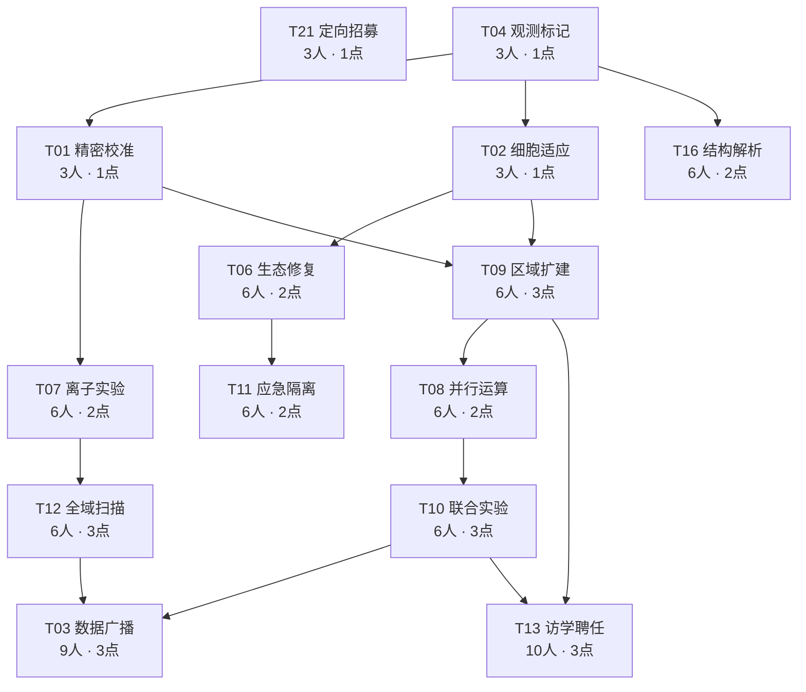

# 莱茵生命与专项研究完整规则（v1.11 / 0.5.1）

修订日期：2026-10-12。已按用户授权并入本体，作为可选测试包“莱茵生命”；rhine-lab-v1／rhine-test-2／客户端能力30。本文取代v1.10正文，旧稿保存在项目外验收历史中。设计总规范仍是[DESIGN.md](DESIGN.md)，具体公式由shared/rhine.js和shared/rhine-balance.js供客户端与服务端共同读取。简介精确为“专项研究”上线。

## 一、定位、身份与作用范围

核心盟约“莱茵生命”为3／6／9／10档，研究与区域是主要选择机制。可获取名单11种形态、9名原作人物：新增梅尔、星源、麦哲伦、星极、淬羽赫默、伊芙利特六种形态；已有赫默、白面鸮、塞雷娅、缪尔赛思、溯光星源五种形态追加归属。娜斯提与多萝西均不在当前可获取名单，多萝西技能／陷阱／素材已从运行内容移除。异格baseId分别计，普通／精锐及同形态副本不多算，手牌不计；调和沿原版虚拟人数规则，但不授予真实莱茵身份。

真实身份来自天然归属、合法场域控制器＋变形同构体组合、或T13局内访学。所有干员科技收益只给本人真实莱茵干员；非莱茵、队友、仅虚拟调和受益者不享收益。召唤物不直接获得科技干员属性，仅明确允许的原生研究与专项研究事件可归于主人。T21是玩家商店效果；对敌科技处理合法敌人。基础攻血也仅给本人莱茵，通用采样器保留自身盟约增层用途。

研究、选格、聘任在休整期进行。休整作战区少于3人时所有科技暂停、数据保留；达到3人出现入口并重新计算各科技自身门槛。开战冻结研究、位置、人数资格和六人强化，战斗减员不会停科技或降档。存活、本人身份、实际位置、目标合法性仍实时检查；死去干员不继续输出，离开格子不继续享区域额外收益。所有区域战斗效果只在战斗中生效。每局一次全额重置不增加收入或返还已用聘任次数。

## 二、基础盟约收益

L为当前科研层数0—999，三人及以上本人莱茵攻击和最大生命均增加(10＋0.1L)%，无额外固定攻击／生命；0／200／600／999层分别为10%／30%／70%／109.9%。不以重复激活回血。

| 人数档 | 首次合法部署预热SP | 额外功能 |
| --- | --- | --- |
| 3 | 3 | 激活研究与面板入口 |
| 6 | 6 | T01与T02的区域额外部分翻倍，全域基础部分不重复翻倍 |
| 9 | 9 | 满足末端广播资格 |
| 10 | 10 | 首次合法休整达到十人额外1科技点，允许审批访学 |

预热仅本场每真实实例首次合法部署，遵守原技力类型、锁与上限，不给召唤物直接授技力；十人点本局一次，人数回退、重置、卸装重装不再领取。

## 三、科研成长与20回合目标

研究层数为本局本人共享资源，最高999。成长按合法回合结算和可信事件记录，沿用既有首领／模式成长锁，不因普通战转联防重复结算。

| 人数档 | 基础科研层数／回合 | 有效区域成果／回合 | 新增角色研究特质共享上限／回合 |
| --- | --- | --- | --- |
| 3 | 6 | 4 | 20 |
| 6 | 10 | 8 | 20 |
| 9 | 12 | 12 | 20 |
| 10 | 14 | 14 | 20 |

基础层数按既定回合节点一次发放；有效区域成果须本回合至少完成一次合法区域实验，只领取一次，不按格数、科技数或事件数重复。有效事件为本人莱茵真实干员或原特质明确允许的原生召唤物，在本人有效科技格完成原生伤敌／治疗／合法承压，或对格内敌人造成有效原生伤害。科技脉冲、扫描、自动恢复、屏障发放等不会自行触发成果。

区域成果只认战斗中已研究、人数／前置符合且选格有效的科技位置；休整只显示地图和位置，不运行区域效果、不记录区域成果，暂停或未选位置不算。原生伤敌可包含合法盾损，原生治疗只计实际HP增加，承压须敌方合法伤害；空奶、空挥、友军自损或无敌拒绝不计。角色特质另按第五节细则计次，共用20层新增特质额度。

实验采样器旧攻击计次奖励已删除；新装备的回合定时增层独立于上述20层额度，但仍受对应盟约成长锁和999上限。角色原有非莱茵成长特质保留，不占新增莱茵特质额度。

成长目标仍是典型正常发育20回合约600层，参考区间560—640。历史602层账本的假设为R3三人、R6六人、R11九人、R20首领成长锁；它是目标参照，不是当前单格、装备与招募条件的实测。新装备可额外加速科研，不能据此宣称新方案已实现600层。十人科技点奖励不增加研究层数。

## 四、科技点收入、奖励与重置

### 三种收入来源

| 来源 | 获取条件 | 本局最多 | 领取规则 |
| --- | --- | --- | --- |
| 正常科研点 | 合法科研层数每跨50层 | 19 | 50、100、…、950各一次，999不产生第20点 |
| 十人基础成果 | 首次合法达到10莱茵人数 | 1 | 与策略独立，不要求研究T13，不因回退再达而重复 |
| 赫默策略 | 首次达到8莱茵人数 | 1 | 仅选择赫默策略时有效 |
| 克丽斯腾策略 | 首次达到3、6、9莱茵人数 | 3 | 每档一次，跨多档补发尚未领档位 |

正常累计＝floor(H/50)，H为本局最高合法已达层数、0≤H≤999。没有首次激活赠点。总累计收入＝正常点＋已领十人点＋已领本策略点；可用点＝累计收入－当前有效研究支出。正常点数与额外点记录分离，不用一个统一19或20上限截断额外奖励。

| 本局策略 | 未领十人点时的收入上限 | 达十人且领完本策略奖励后的上限 |
| --- | --- | --- |
| 无上述两条莱茵专属策略 | 19 | 20 |
| 赫默 | 20 | 21 |
| 克丽斯腾 | 22 | 23 |

600层正常12点；已达十人则13点；再领赫默八人奖为14点，或克丽斯腾三档奖为16点。950／999层正常19点。每局仅选一条局外策略，不合并两策略奖励。

### 研究与退款

科技只有未研究／已研究，全部单级，费用一次支付，不存在科技升级或前置Ⅱ／Ⅲ。研究及持续效果要满足自身人数和全部前置。开战冻结已研究集合、选格、休整人数资格及六人强化状态，禁止战斗编辑；战斗中的死亡、离场或失去身份不会改变本场人数门槛与科技资格。原本依位置、合法目标、干员自身身份和持续时间的效果仍按各科技规则执行，不将人数快照理解为死亡干员继续输出或离格仍享区域收益。

### 休整少于三人整体暂停、开战快照与数据保留

休整按合法作战区阵容计数，不同baseId去重，转职／调和沿原合法人数语义。休整作战区少于3时，全部科技暂停，包括区域资格、技力、应急触发和T21搜卡；休整恢复至少3人时自动恢复科技系统，但各科技仍要满足自身6／9人要求和全部前置。开战前完成T13安排校验及授身份后，保存本场人数、科技资格和六人强化快照。本场战斗死亡或离场不导致科技暂停、降档或重新判人数；下一次休整再更新。

保存科研层数、科技点及已领里程碑、全部已研究科技、所选格与占用、十人及策略领取记录、触发次数和进度、T13审批／聘任及已授身份。暂停不是研究重置，不退点、不清科技、不丢选格、不清一次性标记。3—5人仍可用合法三人科技，六人及九人科技在条件不足时继续暂停，不把回到三人解释为无条件启用所有高档科技。

恢复不重新授预热技力、重置T11次数或T08接力、不返还T21本回合首次刷新机会。战斗时钟照常推进；不因战斗减员跳过T07/T12周期或停用科技。下一次休整不足人数时暂停资格，恢复后按下一场的正常时钟执行，不补发上一场积累效果。休整恢复到六人时T01/T02切回翻倍值，开战后固定。

科技效果随战斗正常结束移除；休整人数不足暂停后续科技资格，原生／装备同类来源不受影响。触发记录与数据保留，不能通过休整暂停／恢复重发同回合一次性效果。已结算的伤害、治疗、已产生的商店结果和已经完成的T13身份授予不回滚；T13已授身份属于完成的局内成果，继续计身份，新的审批／聘任操作在系统暂停时不能进行。

每局一次全额研究重置，退回已花科技点并撤销研究效果，不视为新收入；层数、已领50层节点、十人成果、策略奖励及已用聘任次数不重置。退款不会同时保留旧科技，花点也不会重新开放获取额度。T13重置另撤销资格与身份，已用一次聘任不能返还。

全部14项科技一次性总29点，最大可获23点仍不足全研究；十人提供一次额外选择，不取消预算取舍。

## 五、干员、培养、原生技能与研究特质

### 名单、阶位与职责

| 阶位 | 形态 | 原作ID | 本项目归属 | 来源处理 | 主要职责／默认技能 |
| --- | --- | --- | --- | --- | --- |
| 1 | 梅尔 | char_242_otter | 莱茵生命／灵巧 | 新增 | 召唤师；低阶阻挡与装置试验，默认S1迷惑装置，S2可切爆破回收 |
| 2 | 星源 | char_135_halo | 莱茵生命／奥术 | 新增 | 链术师；低中阶对空与连锁，默认S2星束交汇 |
| 2 | 赫默 | char_108_silent | 莱茵生命／远见 | 已有chess_char_2_02追加 | 单体医疗／治疗无人机；保留默认S2 |
| 3 | 麦哲伦 | char_248_mgllan | 莱茵生命／远见 | 新增 | 召唤师；默认S3武装打击模块补物理输出，S1控场、S2法术开采可切 |
| 3 | 星极 | char_274_astesi | 莱茵生命／奥术／坚守 | 新增，文献学顾问剧情纳入 | 术战者，原挡1；默认S2星辉剑，技能期间原生＋1挡并攻击阻挡目标；S1星座守护可切 |
| 4 | 白面鸮 | char_128_plosis | 莱茵生命／助力／灵巧 | 已有chess_char_4_21追加 | 群体医疗与自然回技支援；保留S2 |
| 5 | 淬羽赫默 | char_1031_slent2 | 莱茵生命／助力 | 新增 | 护佑者；默认S2俯瞰视界，S3无畏者协议保留原次数限制 |
| 5 | 塞雷娅 | char_202_demkni | 莱茵生命／坚守／独行 | 已有chess_char_5_11追加 | 守护者与前排；原默认S2不改，S3可转法伤辅助 |
| 5 | 伊芙利特 | char_134_ifrit | 莱茵生命／奥术 | 新增 | 轰击术师、直线法伤；默认S2炎爆，S3灼地处理高压线 |
| 6 | 缪尔赛思 | char_249_mlyss | 莱茵生命／调和 | 已有chess_char_6_11追加 | 战术家、复制流形、人数衔接；保留原S3和复制规则 |
| 6 | 溯光星源 | char_1047_halo2 | 莱茵生命／奥术／灵巧 | 已有chess_char_6_16追加 | 原高阶辅助／法伤支持与经济成长；保留原技能配置 |

已有五种形态的普通／精锐两档只追加归属和本包研究特质；不重做职业、原默认技能、已有技能目录、原特质、模组、原阶位或素材。

隐藏的五阶白面鸮chess_char_5_16不是新可获取成员，不重开可见性，也不作为第二名白面鸮凑人数。成员展示只保留现有可见四阶形态。

凛视与罗比菈塔不凭主题追加。10种保留形态的原groupId为rhine；星极原groupId为空、nationId为columbia，本项目依据原生模组剧情里的文献学顾问身份纳入核心，明确区分正式势力数据与剧情关系。娜斯提已从当前名单移除。

### 培养与原技能边界

新干员采用本体同阶培养口径：

| 项目阶位 | 普通 | 精锐 |
| --- | --- | --- |
| 1 | 精一55级，技能4级，无模组 | 精二50级，技能7级，真实模组一级 |
| 2 | 精一60级，技能4级，无模组 | 精二55级，技能7级，真实模组一级 |
| 3—5 | 精二1级，技能4级，无模组 | 精二60级，技能7级，真实模组一级 |

六名新增角色共15套原生技能，普通4／精锐7；加已有五形态共28套。首版固定资料底本仍保留被移除的娜斯提记录，当前新增星极2技能及模组见evidence/astesia-original.json；不能把底本旧32技能当成当前新增实现数量。

普通与精锐属性按原作该培养档曲线计算，不手填星级换算攻击。天赋按对应精英阶段和默认潜能读取；不给低阶普通梅尔精二专属效果。未公开的模组不能虚构。

新形态模组建议：梅尔SUM-X、星源CHA-Y、麦哲伦SUM-X／Y、淬羽赫默BLS-X／Y、伊芙利特BLA-X／D、星极AFT-Y，均有固定数据条目。首版精锐以对应真实一级模组为培养档；多选模组沿用局外调配。已有五形态的模组规则保持，不因新盟约重选默认。

首版资料底本见[evidence/native-operators.json](rhine-reference/native-operators.json)，当前替换星极见[evidence/astesia-original.json](rhine-reference/astesia-original.json)。两者包含技能4／7级黑板、SP、持续、天赋与模组。独立副本已接入六名新角色15类技能的普通／精锐30条原生技能记录、9个模组选择及5条召唤物记录；原生机制针对性检查和真实素材完整性检查已通过，详见[RHINE-0.5.1.md](RHINE-0.5.1.md)。原项目召唤物不占干员部署位，因此召唤模组中的部署位减免沿用此规则；不将其标为新增独立收益。

### 新增的莱茵研究特质

下表普通／精锐分别表示奖励层数，不改原生技能数值。全部只在莱茵有效激活且该干员真实在本人作战区时记录；合法事件来自本人及明确允许的原生召唤物。每回合新增角色研究特质共享20层上限，按可信事件顺序发放剩余额度。旧采样器攻击计次奖励取消，新通用装备定时增层另计，仍受成长锁与上限。

同形态多副本共享该形态的次数与上限；不以普通／精锐混用翻倍。异格是不同形态，拥有各自条目。若同一形态普通与精锐都在场，按实际产生事件的档位记奖励，但共用下表较高的单回合上限。重部署和普通战转联防不清次数。

| 干员 | 原创研究特质 | 普通／精锐奖励 | 每回合上限 |
| --- | --- | --- | --- |
| 梅尔 | 机械水獭累计3次有效伤敌或阻挡承受敌人攻击；同一时点的范围伤害只计一次 | ＋1／2层 | 6／12 |
| 星源 | 其原生攻击累计命中3名此前未记录的不同敌人；三名成一组，不重复利用同一敌人 | ＋2／3层 | 6／9 |
| 赫默 | 对站有效支援格的本人莱茵队友累计300点有效原生治疗；包括她的原生治疗无人机，不含满血空奶或科技恢复 | ＋1／2层 | 4／8 |
| 麦哲伦 | 本体／无人机原生攻击或束缚累计作用于3名未记录敌人；每三名结算一次 | ＋2／4层 | 6／12 |
| 星极 | 每累计6次有效原生攻击记录一次，多段同一动作只计一次 | ＋2／3层 | 6／9 |
| 白面鸮 | 对有效支援格本人莱茵成员累计3次有效原生治疗行动；一次群疗只计一个行动 | ＋1／2层 | 4／8 |
| 淬羽赫默 | 支援区内原生治疗实际恢复了生命比例低于40%的真实队友；同一目标每回合最多两次，间隔至少6秒 | ＋2／3层 | 6／9 |
| 塞雷娅 | 站支援区、本体真实阻挡并受到被阻挡敌人攻击期间，每累计8秒记录一次；盾损也可计时 | ＋2／3层 | 6／9 |
| 伊芙利特 | 一次原生攻击实际命中至少2名敌人；共享6秒间隔，多段只计一次 | ＋2／3层 | 6／9 |
| 缪尔赛思 | 本轮本体和流形都完成至少一次有效原生伤敌，且发生时站在不同的本人生效区域 | 一次＋4／6层 | 4／6 |
| 溯光星源 | 开启原生技能后首次有效攻击命中合法敌人；每次真实开技只能记录一次 | ＋3／5层 | 6／10 |

“真实阻挡并受攻击”承压计时：本人实际阻挡至少一敌人，最近2秒内收到来自该被阻挡敌人的实际生命／护盾损失，且本人站支援区；条件满足时累积模拟时间，失效暂停不清进度。环境自损、献血、感染、友军攻击不计。

有效伤敌包括消耗敌人合法护盾；无敌、闪避、未命中和空挥不计。有效治疗只计真实HP上升，屏障不当治疗。科技T07／T12、装备定时增层或屏障不计原生伤敌记录。

原来的赫默休整成长、白面鸮与塞雷娅复制特质、溯光星源资金成长等都保留。新增研究特质属于独立莱茵记录，不能被原特质复制、投资人获得倍数或魔王追加再次放大；不是更改原引擎，只是定义这类新研究奖励不属于可复制的原特质事件。

### 召唤物与装置体验

区域覆盖与召唤物是两套独立系统。选一格实验区不会免费生成麦哲伦无人机或机械水獭。

梅尔机械水獭依原生天赋数量和技能回收规则，初期可以作为接敌支点。部署仍消耗原生DP、真实召唤物格位；召唤物不是干员部署人数，但不能无限同格叠放。S2回收不是永久消灭库存，后续部署依原技能补充和回收逻辑。

麦哲伦无人机随所选技能切换控制／法伤／物理行为；S1原生停顿／束缚与实验区减速取原状态优先级。S3推荐用于补物理伤害，但不能因此让S1被强制输出化。

赫默与淬羽赫默无人机维持其原作持续时间、治疗／庇护资格和离场销毁规则，不变成常驻区域。

缪尔赛思流形原复制属性、分裂、阻挡和远程形态原样保留；科技不对已复制面板再重复加攻击／生命。首稿不改调和的其他核心共享规则，不让流形提供额外人数。

#### 星极原生技能边界

默认S2星辉剑：技能4级攻击／防御各＋45%，SP27、初始3；技能7级攻击／防御各＋60%，SP24、初始6。S2在技能期间临时＋1挡，并攻击自身阻挡目标，不是永久挡2。S1星座守护技能4级攻＋30%防＋45%，SP37；7级攻＋40%防＋60%，SP34，保留原持续时间，不追加S2的加挡效果。

天体仪原生每在场20秒叠攻速，精一＋3、精二＋5，最多5次；不因新盟约改成瞬间满层。模组AFT-Y“未卜星图”固定数据有记录，精锐使用真实一级模组。剧情纳入依据是该模组原文的文献学顾问身份，不更改原角色JSON势力。

星极没有高台、召唤装置承载、建造资源或新增部署界面。三阶普通精二1／技能4、精锐精二60／技能7口径保持，原基础阻挡1；地面稳线仍需梅尔水獭、正确技能时机和后期塞雷娅。

### 可用阵容与短板

| 时段 | 示例阵容 | 作用与代价 |
| --- | --- | --- |
| 早期3人 | 梅尔、星源、赫默 | 水獭接敌、连锁清杂、医疗支援；地面仍依赖召唤物，需合理留DP |
| 中期6人 | 上述三人＋麦哲伦、星极、白面鸮 | 星极近战法术和技能加挡，无人机补物理，白面鸮自然回技；输出人数偏少，科技不能全买防守 |
| 后期9档，8真实 | 梅尔、星源、赫默、星极、麦哲伦、塞雷娅、伊芙利特、缪尔赛思＋调和虚拟一人 | 双区联动、物法混合、稳定前排；至少一名六阶和两个五阶，成本明确 |
| 十人档，9真实 | 上述八人再加入淬羽赫默＋调和虚拟一人；需既有人事部文档扩至9位 | 取得访学研究资格后，可将一名非调和成员换成研究席上的外部主力；不增加部署位 |
| 高阶替换 | 用淬羽赫默或溯光星源替换不再需要的低阶 | 提升保护或辅助，可能损失物理输出／原生召唤数量；不强制全高阶 |

阵容主要短板：低阶原生阻挡与前排生命有限；高阶集中于辅助、法术，物理路线依赖麦哲伦无人机与外援；研究预算有限，科技投防守后输出可能不足；高级门槛需要真实招募成本。星极补中期近战输出，但永久挡1的短板需由原生水獭和后期塞雷娅协作，外援与合法转职保留为额外路径。T13访学聘任提供一名局内成员：仅绑定实例追加身份，不新增天然名单或免费复制本表的研究特质。20回合约600层目标采用基础6／10／12／14、成果4／8／12／14与本表条件奖励；新增角色研究特质额度为20层；新装备定时增层不占此额度，旧账本需重新验证。

研究特质中的“支援区”指已启用的T01／T02／T03／T06格，不限于末端T03。有效伤害、盾损与治疗分别沿事件接口记录；当前实现治疗研究只认本人莱茵受益者。专项研究二次爆炸、科技恢复与伤害不参与新增研究成长。

## 六、六层单级科技树

14项、15条前置关系、一次性总支出29点。每层最多3项；T15和T18等已删节点不恢复。人数门槛是本人莱茵计数，所有前置须同时满足。

实际菜单固定行排列：T21／T04 → T01／T02／T16 → T07／T06／T09 → T12／T11／T08 → T10 → T03／T13。Mermaid表达前置关系；界面按这六行纵向滚动，不依自动排版重排。

| 层 | 科技 | 人数 | 点数 | 前置 | 具体效果 |
| --- | --- | --- | --- | --- | --- |
| 1 | T21 定向招募 | 3 | 1 | 无 | 每回合前1次主动刷新，优先出现1名当前可招募的莱茵核心干员；刷新与购买照常付费，遵守当前商店阶数及候选池，不提供免费刷新 |
| 1 | T04 观测标记 | 3 | 1 | 无 | 选1个实验格；格内敌人减速50%且显隐，实验标记离格保留3秒；受本人莱茵原生有效伤害后追加实际生命伤害10%的真实科技伤害 |
| 2 | T01 精密校准 | 3 | 1 | T04 | 所有本人莱茵原生直接物/法/真伤害增加20%＋每层0.05个百分点；选格内额外增加30%＋每层0.05个百分点，六人翻倍区域额外部分；支持所有可部署格含高台 |
| 2 | T02 细胞适应 | 3 | 1 | T04 | 所有本人莱茵所受合法敌伤降低10%＋每层0.01个百分点；选格内额外降低20%＋每层0.02个百分点，六人翻倍区域额外部分，合计最多减伤75%；支持高台 |
| 2 | T16 结构解析 | 6 | 2 | T04 | 本人莱茵原生物法攻击标记敌人：防御≥800时无视60%防御，法抗≥40时无视25点法抗 |
| 3 | T07 离子实验 | 6 | 2 | T01 | T04观测标记追加追踪脉冲；开战2秒首轮、此后每1秒，对最多3名已标记敌人各造成1200＋12L法术科技伤害，优先高生命敌人；不独立选格 |
| 3 | T06 生态修复 | 6 | 2 | T02 | 所有本人莱茵每秒恢复当前最大生命1%，所选恢复格内改为3%；仅战斗生效 |
| 3 | T09 区域扩建 | 6 | 3 | T01＋T02 | T01/T02/T04各自可选格数+1，由1变2；所有科技选格仍互斥 |
| 4 | T12 全域扫描 | 6 | 3 | T07 | 存在有效T04格时，开战2秒首扫、此后每10秒，全战场合法敌人显隐并获得实验标记6秒；区外不附加T04减速 |
| 4 | T11 应急隔离 | 6 | 2 | T06 | 每名本人莱茵本场一次：敌伤后生命≤40%或首次致命敌伤时应急救援，致命时保留1生命；恢复最大生命30%，获得最大生命50%屏障8秒，解除晕眩/冻结并免疫5秒 |
| 4 | T08 并行运算 | 6 | 2 | T09 | 所有本人莱茵自然技力额外＋1/秒；本场3名不同莱茵成员首次开技后，所有本人莱茵额外回复8技力一次 |
| 5 | T10 联合实验 | 6 | 3 | T08 | T01与T04至少一对选格正交相邻时，所有本人莱茵原生物法对标记目标增伤50%；T01格内成员原生伤敌也标记3秒；T07上限增至5，脉冲命中停顿0.5秒 |
| 6 | T03 数据广播 | 9 | 3 | T10＋T12 | 选1个支援格含高台；格内存活莱茵将当前攻击力100%固定赠予本人其他所有场上莱茵；剔除所有广播赠攻、源本人不领；有效广播时所有本人莱茵攻速＋30 |
| 6 | T13 访学聘任 | 10 | 3 | T10＋T09 | 独立十人审批后休整选1个研究席格，与合法T04格正交相邻；至少6人且T10/T09资格满足时确认外部干员安排，开战校验在席后授本局莱茵身份，不占装备槽；实际授予成功才消耗一次聘任 |

## 七、逐项结算和区域规则

每项区域科技初始只选一个单格；所有科技选格互斥，暂停科技的保存位置仍占配置格。T09使T01／T02／T04各多一个格，恢复人数或重置不重复扩建。未选格不自动安排。T01／T02／T03支持权威deployMap内所有可放干员的格，包括高台及原地形被合法平台设备覆盖后的格；不依据旧地形字符拒绝。其他区域沿当前规则检查合法本场格。联防只选择本人半场，转换后坐标与战斗镜像一致，不改变部署／寻路。

T01原生直接物理／法术／真实伤害倍率为1＋全域加成＋合法本格额外加成。六人只双倍本格额外部分；不放大科技、装备、反伤、分摊或无来源生命流失。T02在原伤害管线内减少合法敌伤，科技全域＋区域合计最多75%，不抵消主动自损。两者均按当前L成长，开战冻结人数。

T03先移除所有已有广播赠攻，再取存活格内莱茵源的当前攻击力，最高源生效；固定赠予本人其他场上莱茵，不让受益者的百分比再乘该赠攻，不反馈循环。源不领自己的赠攻，但有效广播时本人所有莱茵含源攻速＋30。源死亡／离格后停止，实时更新。

T04只在格内施加50%减速，显隐与实验标记离格保留3秒。标记敌人受到本人莱茵原生有效生命伤害后追加该实际生命伤害10%真实科技伤害；护盾损失不算HP伤害，击杀后不再制造二次命中。二次伤害不能递归或参与原生成长。多人不同T04接触同一巨大敌人只施加一次同名50%减速，仍保留各人的独立标记归属。

T07开战2秒首次、每1秒追踪已标记合法敌人，无须仍在原格；各格合计最多3个，优先当前最大生命较高目标。法术底伤1200＋12L，仍经原法抗及伤害规则。T12也先2秒，随后每10秒扫全场，标记与显隐持续6秒，区外不获得T04减速。T10需T01与T04至少一对正交相邻；满足时对标记目标的原生物法额外增伤50个百分点，T01格内成员原生伤敌可远程接力3秒标记，脉冲目标增至5并停顿0.5秒。停顿按原状态规则，不把不可控首领改成可控。

T06全域每秒最大生命1%，本格改3%，无来源科研恢复，不触发专项研究或原生成长。T08只有自然技力额外每秒1点；三名不同莱茵首次开技后本场一次给本人莱茵8SP，不改原技力锁／上限。T11每莱茵实例本场一次，合法敌伤使HP≤40%或首次致命敌伤时救援；致命伤保留1HP，再回30%最大生命，授50%屏障8秒，清晕眩／冻结并免疫5秒；不保护献血自损。与控制器同名屏障取较大剩余量及原接口持续时间，不相加。

T16仅本人莱茵原生物法对标记敌人生效：DEF≥800无视60%防御，RES≥40无视25点法抗；阈值按敌人当前属性，不重写敌人底表。T21每回合前一次付费主动刷新优先一名当时可招募莱茵核心，库存、阶数、禁用沿原规则；免费刷新不耗这次机会，买卡仍需资金。

T13至少十人时单独审批并花3点研究，须T10＋T09。审批后可调整阵容到至少六人，选与有效T04正交相邻的独立研究席，安排在席外部真实干员；开战再次校验，成功后该实例本局成为莱茵，保留原盟约／技能和装备槽。一次聘任仅实际成功才用掉；不新增部署位、不复制天然研究特质，合成／出售／作为材料及重置按实例规则撤销，不返还已用次数。不能预支未来访学身份拿十人奖励。

## 八、专项研究附加盟约

成员限定星源、溯光星源、赫默、淬羽赫默；普通／精锐同形态去重，2／4档。独立于莱茵核心科技资格：核心不足3时，若专项研究自身至少2人仍按附加盟约工作；不会授予其他干员专项研究身份。无层数成长，weight和bb.banWeight均0。

| 触发 | 二人效果及共享CD | 四人变化 |
| --- | --- | --- |
| 成员原生有效攻击伤敌 | 以受击敌人为中心，1格半径内合法敌人受到该次实际HP伤害150%的法术爆炸，并减速50%持续1秒；攻击通道10秒 | 攻击通道8秒 |
| 成员原生治疗真实恢复干员HP | 以受治疗干员为中心，1格半径内合法敌人受到实际恢复HP300%的法术爆炸，并晕眩0.5秒；治疗通道10秒 | 治疗通道5秒 |

两通道各由本人盟约所有成员共享一套计时，互不影响，其他玩家独立计时。原生技能伤害可触发，不限普攻；原生治疗无人机归主人并消耗同一共享CD。治疗爆炸只伤敌，受治疗队友不受伤。爆炸底伤基于结算后的实际HP伤害／有效治疗量，之后仍过目标法抗及合法命中判定；不把最终伤害承诺为无视防御。

空击、纯盾损、满血空奶不消耗CD。爆炸带盟约二次标签且不触发自循环、T04附伤或原生成长；科技恢复、T11应急回血不触发治疗爆炸。状态免疫及不可控首领沿原规则；两套效果采用不同范围特效颜色，攻金黄、治青绿。

## 九、局外策略与两件装备

两条策略保留生命29／26；两装备保留四阶／三阶、普通2／进阶5资金报价。本节是当前效果，不叠旧攻血、自然回技、采样计次或站稳增伤。普通／进阶沿原版报价量级；装备本身未纳入此次无装备战斗评估，不能将其效果混入科技提升结论。

### 两条局外策略

| 策略 | 保留生命 | 当前效果 | 本局科技点额外奖励 |
| --- | --- | --- | --- |
| 赫默 · 联合招募 | 29 | 第2、第3回合分别随机获得1名莱茵生命干员，阶数不高于奖励结算时当前商店阶数；本局首次达成8莱茵人数，额外1科技点 | 最多1点 |
| 克丽斯腾 · 阶段成果 | 26 | 本局首次达成3、6、9莱茵人数时，分别额外1科技点 | 最多3点 |

赫默两次赠卡各独立随机，允许随机到同名普通角色；使用当局合法莱茵核心候选名单，含设计纳入的星极，排除隐藏、禁用、借用和访学外部角色。无需先激活三人；不花买卡资金、不产生主动刷新，不保证新增不同姓名或精锐。按本体已有赠卡接收规则处理手牌满，不因反复打开界面重复发奖；合法池空时保留该次待领取记录，后续首次有合格池时按当时商店阶数结算。

人数里程碑沿当前莱茵盟约的合法作战区计数，不同baseId去重，合法装备／访学身份有效，手牌不计，调和人数按本体原计数语义。在合法休整阵容更新时检查，不需要研究对应科技；已领点数不会因战斗中死亡导致人数下降而撤回。每档本局只领一次，直接跨多档则一次补发尚未领的已达档位。换人、掉人数再升、卸装重装、重置科技不刷新领取记录。

两条策略均不再给主动刷新优先卡，也不增强基础攻血20%。搜卡效果移至T21。保留沿本体普通策略候选与核心禁用规则，单局选择一条，不叠加两策略奖励。正常科技点最高19，十人基础盟约奖励另1点；达到十人并领完奖励后，选赫默总计最高21，选克丽斯腾最高23。未领十人奖励时，相应上限仍是20／22。

### 两件装备

保留莱茵场域控制器和实验采样器，分别重写为专属防护和通用增层。删除隔离防护膜、定点作战镜；旧四件装备效果不残留。

| 装备 | 普通，2资金 | 进阶，5资金 | 类型 |
| --- | --- | --- | --- |
| 四阶 · 莱茵场域控制器 | 每回合第一次受到攻击时，获得触发时最大生命值10%的屏障 | 屏障比例改为25% | 莱茵专属；与变形同构体同时装备时追加莱茵盟约 |
| 三阶 · 实验采样器 | 每回合使装备者所有已激活的自身盟约各＋1层；若其中有莱茵，莱茵替换为＋2层 | 其他盟约仍各＋1层，莱茵替换为＋3层 | 通用，不要求莱茵；不提供转职 |

两件不附旧攻击30/50%、攻击25/45%、生命25/45%、回技0.15/0.25、10次攻击采样或站4秒增伤。普通／进阶差异严格按当前屏障与莱茵增层数字。

#### 莱茵场域控制器：首击屏障与身份

屏障受益者须拥有本人合法莱茵身份。控制器本身不授身份；与变形同构体占用双槽配对后追加莱茵，配对后的干员即可触发屏障并享身份限定科技。拆除组合只撤销装备身份来源，已有天然或访学来源不受影响。

以本体合法敌方攻击命中事件为准，普通攻击和作为攻击结算的技能攻击可触发；自损、生命流失、单独持续伤害及无效／闪避／无敌拒绝的攻击不消耗首击机会。先确认合法攻击，再在该次伤害结算前授盾，因此第一击也能被此盾吸收。按触发瞬间当前最大生命计算，不是基础生命；最大生命2000时普通200、进阶500。

同实例每回合一次，普通战和联防共用；重部署、临时死亡后返回、卸装重装或升级同一装备不重置。已触发实例再换普通／进阶不补盾；未触发时按命中当时合法最高档。屏障持续到耗尽或本回合结束，残余不带入下一回合；同名环境屏障与T11取较大当前剩余，不直接相加。不把每回合一次写成每Battle一次。

#### 实验采样器：自身激活盟约增层

在每回合休整结束、阵容与装备确认后结算一次。携带者须真实在本人作战区；目标为本人当时已激活且携带者实际拥有的盟约，按盟约ID去重，不给其不拥有的全队盟约、未激活盟约、队友盟约或手牌角色增层。

莱茵2／3层替换通用1层，不是1＋2或1＋3。若携带者拥有已激活莱茵与奥术，普通加莱茵2、奥术1，进阶加莱茵3、奥术1。通用装备不授莱茵身份；与变形同构体组合也不建立本包转职映射。

同实例同名多件只取最高档；不同真实携带者各自结算、层数可累加。一个普通和一个进阶合法莱茵携带者，每回合合计莱茵＋5层。处理同回合快照一次，不因改变装备顺序或普通战／联防重复结算。

增层写入本人对应盟约公共层数，遵守各盟约既有成长锁、不可叠层语义及层数上限；莱茵最高999。不占新增角色研究特质20层条件额度，也不产生独立科技点奖励：只通过合法层数跨过50里程碑获得正常点。因此多装备加速达到999，也不能超过19个正常科技点。

装备转职导致合法人数达到十人或策略档位时，按第四节对应一次性记录发奖励；这与装备增加层数产生的正常点是不同来源。多个身份来源只证明同一实例身份，不重复计人数或重复发点。

## 十、菜单、选格与版本入口

科技菜单使用六层纵向滚动树，卡片显示编号／名称／效果／人数／前置／一次性点数及状态，当前数值读取同源公式。正常点最高19，十人及策略点单列，累计、已花、可用分别展示；每局一次重置显示退款及访学撤销后果。

区域启用后点“选择位置”打开2D俯视当前真实地图，显示部署与地形、已占用科技格和剩余可选数量；点击预览后确认保存，取消不改位置。T01／T02／T03高台及平台按legalFor资格直接可选。选格前后服务端重新核验人数、前置、位置与互斥，客户端预览不授休整属性。T07为T04附加效果，不独立选格。

战场选格内出现低透明度六角R主题标志：T01金#ffce78、T02蓝#79b8ff、T03紫#c69cff、T04红#ff8299、T06绿#8ad9a1、T13青#71dfd4；T09追加格同色。标志与普通选中高亮独立；暂停更淡，配置保留，战斗锁定，不遮住角色／地形。

主界面版本入口长期放右上角，小字可点击；标题与跳过标题的大厅都挂载同一VersionInfo组件，触屏点击区域至少44px。点击标准Modal显示v0.5.1及精确简介“专项研究”上线；支持关闭、Esc及点击背景，版本和简介来自shared/constants.js，不分别硬编码。桌面1280×720、手机844×390／568×320均完成点击验证。

## 十一、预算、数值与平衡边界

T04＋T01＋T07最低4点；加T12全域扫描最低7点。T10最低链11点（含T04／T01／T02／T09／T08／T10），T03同时要求扫描链合计最低19点；T13最低14点且先满足十人审批。总收入20／21／23都低于29，不能全科技。人数资格不足暂停后恢复，预算不退款。

600层、六人T01全域增伤50%，本格额外120%，合计170%，原生伤害倍率2.7；T02全域16%，本格合计受75%上限约束；脉冲每目标8400法术底伤。800层本格T01＋200%，脉冲10800，999层＋229.85%、脉冲13188。实际总强度还受队伍攻击、法抗、站位、目标上限、点数及技能限制。

此次评估使用正式ABYSS波次、真实部署规则与原生技能，但预设阵容和晋升、无完整搜卡经济。R19普通八部署样本599—636层，与20回合约600层目标接近；不将此描述为真人稳定可达。14回合前6—7正常点，24回合前15—17正常点，需取舍科技路线。详见[评估报告](RHINE-BALANCE-0.5.1.md)。

## 十二、实现、来源与更新

纯ESM共享规则、本局数据副本、服务端权威休整意图、客户端同源BattleSpec；使用SIM公开事件／伤害／治疗／状态接口，META统一接入。既有正式data JSON、其他测试包数值／权重、私有账号与配置保持；本轮复用轻量联机安装包，不重建离线APK。

原作GameData固定e8588a82074bf695aa3849959037dd2de7e6e5cf；资源底本fexli固定d0b5af0b004b044d322397ce5ae79632b6d9fcdd。生成入口tools/build-rhine.mjs、tools/content/rhine.json，资产入口tools/fetch-rhine-assets.mjs，104项保留原生资源逐项校验，科技／装备／专项研究图标是原创SVG。历史[native-operators](rhine-reference/native-operators.json)含已退出角色的源资料，不是当前运行名单；[星极资料](rhine-reference/astesia-original.json)及[素材清单](RHINE-ASSETS.json)提供固定数据证据。

集成与验收见[RHINE-0.5.1.md](RHINE-0.5.1.md)，保留数据的服务器更新见[SERVER-UPLOAD-0.5.1.md](SERVER-UPLOAD-0.5.1.md)。源码已集成、尚未自动部署，普通用户按后台显式开放使用。
