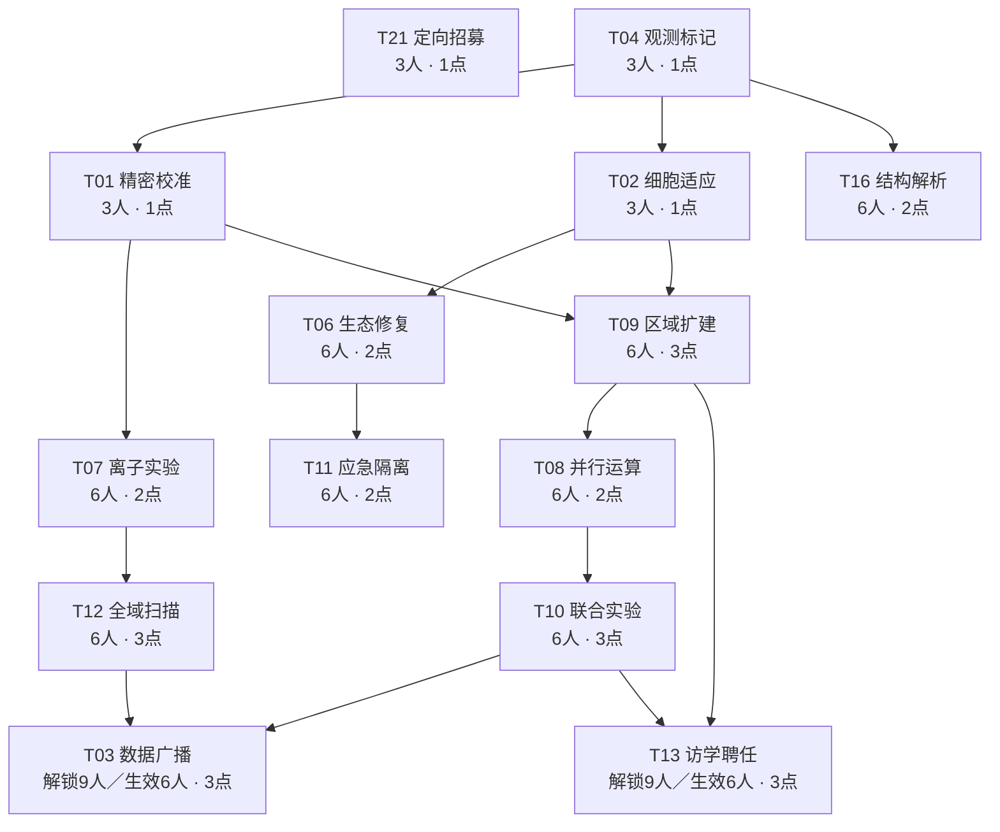

# 莱茵生命与专项研究完整规则 v1.13（0.5.3）

2026-10-12，用户最新修改的实现规则。rhine-lab-v1／rhine-test-4／客户端能力32，默认私有，莱茵生命和专项研究禁用weight及bb.banWeight均0。总规范为[DESIGN.md](DESIGN.md)；旧v1.12及0.5.2评估作为历史记录，旧数值不再用于当前战斗。

## 一、核心盟约与身份

莱茵生命3／6／9／10档。本人真实莱茵干员攻击力和最大生命各＋（10＋0.1L）%，L最高999，取消额外固定攻血；非莱茵、队友、仅调和虚拟人数的受益者不获得此项收益。首次部署技力分别＋3／6／9／10，按原技力锁与上限，每本场实例首次部署一次。召唤物不直接重复吃科技属性，原生复制按原规则。

科技受益者包括天然成员、莱茵场域控制器＋变形同构体合法转职，以及T13授予的本场身份干员。原技能、原盟约与装备槽保留。专项研究成员仍只为星源／溯光星源／赫默／淬羽赫默；转莱茵不自动转专项研究。普通／精锐同形态不重复计人数，异格独立，手牌不计，调和虚拟人数按原版核心计数规则但不授真实身份。

研发门槛保持原3／6／9人要求；3人和6人科技开战分别需要3人和6人，高于6人的科技解锁后开战只需6人。每次开始战斗均按当前作战区盟约重新检查生效人数和全部前置。已研发但门槛不足的科技本场不生效，数据保留；下一场恢复人数后重新启用，不沿用上场或普通战的资格。开战后的本场死亡、离场不再修改资格；干员身份、存活、实际位置与敌人合法性仍实时检查。休整少于3人所有科技暂停，回到3人显示入口；所有区域战斗效果仅战斗生效，休整只是预览与保存配置。

T13仍需9人才能研发；已研发后先以授予身份前的合法人数至少6及前置检查是否启用，5人不能靠未来访学身份补足生效门槛。满足后在战斗输入中对所选格上的本人非莱茵真实干员加临时身份，重新计算本场人数及科技资格，然后固定本场快照。身份不写入休整棋子，不用于休整十人／策略奖励，不继承给合成或出售，不改变永久归属。每场自动重做，换格或换人后作用于新的在格干员。

生效的T13研究席内本人莱茵干员同时享受有效T01和T02的当前区域额外加成，包括天然、装备和访学身份。开战6／9／10档额外增伤15%／20%／30%、额外减伤16%／24%／32%；与全体收益合计增伤30%／40%／60%、减伤20%／30%／40%。离开研究席即失去这份区域额外收益，身份及全体收益按本场规则保持。各区域额外加成只计一次，仍只占一个T13科技格；不兼作T01/T02所选格，不新增T10邻接／标记或T09扩格联动。休整和人数不足时无效。

## 二、科研成长与点数

| 人数 | 基础成长／正常回合 | 一次有效区域成果 | 新增研究特质共享额度 |
| --- | --- | --- | --- |
| 3 | 6 | 4 | 20 |
| 6 | 10 | 8 | 20 |
| 9 | 12 | 12 | 20 |
| 10 | 14 | 14 | 20 |

科研最高999层，每跨50层获得1正常科技点，正常最多19点。按本局最高合法层数记账，不因回退、重置重复领取；没有首次激活赠点。首次休整合法达10人额外1点；赫默策略首次8人另1点；克丽斯腾首次3／6／9各1点。单局一策略，总收入无上述策略最高20、赫默21、克丽斯腾23，全部科技29点，十人也不能全买。

正常战有效原生伤敌／治疗／承压在本人有效科技格完成，或对格内敌人原生伤敌，可领取本回合一次区域成果。科技脉冲、二次爆炸、科技恢复、反伤、自损、空奶不刷研究成果或原生特质。新增研究特质同形态共用额度、异格分别记录，总共享20层；原特质保留。普通转联防不重复回合奖励，首领／隐藏沿原成长锁。采样器定时增层独立于20额度、仍受成长锁和999上限。

每局一次休整全额重置清研究和选格、返还支出，不重置层数／已领里程碑／策略点。新的T13没有审批、候选安排、一次聘任或永久身份记录；旧g.rhineHire请求明确拒绝，玩家只用“选择位置”。

## 三、完整单级科技树

14项单级、15条前置、总费用29点，固定六行T21／T04 → T01／T02／T16 → T07／T06／T09 → T12／T11／T08 → T10 → T03／T13，每行最多3项，纵向滚动。全部前置同时满足；保留各费用和前置，T03／T13仍9人研发、已研发后6人生效，已删节点不恢复。

| 层 | 科技 | 解锁人数 | 开战生效人数 | 科技点 | 前置 | 效果 |
| --- | --- | --- | --- | --- | --- | --- |
| 1 | T21 定向招募 | 3 | 3 | 1 | 无 | 每回合前1次主动刷新，优先出现1名当前可招募的莱茵核心干员；刷新与购买照常付费，遵守当前商店阶数及候选池，不提供免费刷新 |
| 1 | T04 观测标记 | 3 | 3 | 1 | 无 | 选1个实验格；格内敌人减速50%且显隐，实验标记离格保留3秒；受本人莱茵原生有效伤害后追加实际生命伤害10%的真实科技伤害 |
| 2 | T01 精密校准 | 3 | 3 | 1 | T04 | 所有本人莱茵原生伤害增加10%/15%/20%/30%（3/6/9/10人）；所选格内额外增加相同幅度，合计20%/30%/40%/60%，不随层数增加；支持所有合法部署格 |
| 2 | T02 细胞适应 | 3 | 3 | 1 | T04 | 所有本人莱茵受到敌伤降低2%/4%/6%/8%（3/6/9/10人）；所选格内额外降低8%/16%/24%/32%，合计10%/20%/30%/40%，不随层数增加；支持高台 |
| 2 | T16 结构解析 | 6 | 6 | 2 | T04 | 本人莱茵原生物法攻击标记敌人：防御≥800时无视60%防御，法抗≥40时无视25点法抗 |
| 3 | T07 离子实验 | 6 | 6 | 2 | T01 | 开战2秒首次，此后每1秒，只对T04所选格内最多3名合法敌人各造成120＋2L物理科技伤害，优先高生命敌人；不独立选格，离格或仅有实验标记不会受到脉冲 |
| 3 | T06 生态修复 | 6 | 6 | 2 | T02 | 所有本人莱茵每秒恢复当前最大生命1%，所选恢复格内改为3%；仅战斗生效 |
| 3 | T09 区域扩建 | 6 | 6 | 3 | T01＋T02 | T01/T02/T04各自可选格数+1，由1变2；所有科技选格仍互斥 |
| 4 | T12 全域扫描 | 6 | 6 | 3 | T07 | 存在有效T04格时，开战2秒首扫、此后每10秒，全战场合法敌人显隐并获得实验标记3秒；区外不附加T04减速 |
| 4 | T11 应急隔离 | 6 | 6 | 2 | T06 | 每名本人莱茵本场一次：敌伤后生命≤40%或首次致命敌伤时救援，致命时保留1生命；获得无敌2秒，恢复最大生命30%，获得最大生命50%屏障8秒，解除晕眩/冻结并免疫5秒 |
| 4 | T08 并行运算 | 6 | 6 | 2 | T09 | 所有本人莱茵自然技力额外＋1/秒；本场3名不同莱茵成员首次开技后，所有本人莱茵额外回复8技力一次 |
| 5 | T10 联合实验 | 6 | 6 | 3 | T08 | T01与T04至少一对选格正交相邻时，所有本人莱茵原生物法对标记目标增伤50%；T01格内成员原生伤敌也标记3秒；T07上限增至5，脉冲命中停顿0.5秒 |
| 6 | T03 数据广播 | 9 | 6 | 3 | T10＋T12 | 选1个支援格含高台；格内存活莱茵将当前攻击力50%固定分享给本人其他所有场上莱茵；剔除广播赠攻，源本人不领；有效广播时所有本人莱茵攻速＋30 |
| 6 | T13 访学聘任 | 9 | 6 | 3 | T10＋T09 | 9人解锁；研发后每场开战授予身份前至少6莱茵且前置满足时，所选合法部署格上的本人非莱茵干员获得莱茵身份，仅本场战斗有效。研究席内莱茵成员另享有效T01/T02当前区域额外增伤和减伤，各计一次。自动授予，无需安排、相邻条件或一次性聘任，不占装备槽 |

## 四、区域与结算边界

区域初始1个单格，所有科技选格互斥；T09仅使T01／T02／T04各多1格。选格点击“选择位置”，2D俯视图显示本人真实地图、地形、棋子和已占科技格，确认保存，取消保留旧位置。T01／T02／T03／T13支持权威deployMap所有合法部署格，含高台和设备平台；T13不再要求与T04相邻。联防按本人半场／镜像坐标转换。位置配置不改地形、部署或寻路。

| 莱茵人数 | T01全体／本格额外／格内合计 | T02全体／本格额外／格内合计 |
| --- | --- | --- |
| 3—5 | 10%／10%／20% | 2%／8%／10% |
| 6—8 | 15%／15%／30% | 4%／16%／20% |
| 9 | 20%／20%／40% | 6%／24%／30% |
| 10及以上 | 30%／30%／60% | 8%／32%／40% |

T01与T02不随L成长，不叠旧六人双倍；全体与区域额外同项相加。T01只放大本人莱茵原生物法真伤，不再放大科技、装备、反伤、分摊或无来源生命流失。T02只减合法敌伤，不保护主动自损；沿原伤害管线。

T04格内敌人减速50%，显隐与标记离格保留3秒；本人莱茵原生有效HP伤害后追加该实际生命损失10%的真实科技伤害。纯盾损和二次科技伤害不触发，不递归。多人相同T04减速不乘叠，保留各人标记归属。

T07开战2秒首次，每1秒只处理当时实际位于T04所选格内的合法敌人，各格合计最多3个，按当前最大生命优先；底伤120＋2L，类型物理，经过原防御。离格、T12扫描和T10远程接力形成的区外标记都不能让脉冲追踪到区外。T10联动条件仍为T01／T04至少一对正交相邻，原生物法对标记目标增伤50%，T01格内原生伤敌接力标记3秒，格内脉冲上限5并停顿0.5秒；控制免疫沿原规则。

T12开战2秒首次，此后每10秒全场合法敌人显隐并获得实验标记3秒；区外不获得T04减速或T07脉冲。T03取存活支援格最高攻击源，先剔除所有旧广播赠攻，再将其当前攻击50%固定分享给本人其他莱茵，源不领自己的赠攻，不被受益者百分比再次放大；有效广播所有本人莱茵含源攻速＋30。源死亡／离格后停止。

T06全域每秒当前最大生命1%，格内改3%，不触发专项研究或原生研究。T08自然SP额外1/秒、三名不同成员首次开技后本场一次回复本人莱茵8SP，遵守原锁与上限。T11每莱茵实例本场一次：敌伤后HP≤40%或首次致命敌伤时救援；致命保留1HP，立即2秒无敌、回30%最大HP、50%屏障8秒、解晕眩／冻结及免疫5秒。无敌走原公开Buff标志，时间结束正常受伤；不对主动自损触发救援。同名环境盾取较大剩余，不叠加。

T16对标记敌人的本人莱茵原生物法，DEF≥800无视60%防御、RES≥40无视25点法抗。T21每回合前一次付费主动刷新优先1名当前可招募莱茵，遵守阶数／库存／禁用，免费刷新不耗机会，不送买卡资金。

科技格以低透明度六角R图形区分：T01金、T02蓝、T03紫、T04红、T06绿、T13青；暂停变淡，保留配置，独立于普通选中高亮。

## 五、干员、培养、原生技能与研究特质

### 名单、阶位与职责

| 阶位 | 形态 | 原作ID | 本项目归属 | 来源处理 | 主要职责／默认技能 |
| --- | --- | --- | --- | --- | --- |
| 1 | 梅尔 | char_242_otter | 莱茵生命／灵巧 | 新增 | 召唤师；低阶阻挡与装置试验，默认S1迷惑装置，S2可切爆破回收 |
| 2 | 星源 | char_135_halo | 莱茵生命／奥术 | 新增 | 链术师；低中阶对空与连锁，默认S2星束交汇 |
| 2 | 赫默 | char_108_silent | 莱茵生命／远见 | 已有chess_char_2_02追加 | 单体医疗／治疗无人机；保留默认S2 |
| 3 | 麦哲伦 | char_248_mgllan | 莱茵生命／远见 | 新增 | 召唤师；默认S3武装打击模块补物理输出，S1控场、S2法术开采可切 |
| 3 | 星极 | char_274_astesi | 莱茵生命／奥术／坚守 | 新增，文献学顾问剧情纳入 | 术战者，原挡1；默认S2星辉剑，技能期间原生＋1挡并攻击阻挡目标；S1星座守护可切 |
| 4 | 白面鸮 | char_128_plosis | 莱茵生命／助力／灵巧 | 已有chess_char_4_21追加 | 群体医疗与自然回技支援；保留S2 |
| 5 | 淬羽赫默 | char_1031_slent2 | 莱茵生命／助力 | 新增 | 护佑者；默认S2俯瞰视界，S3无畏者协议保留原次数限制 |
| 5 | 塞雷娅 | char_202_demkni | 莱茵生命／坚守／独行 | 已有chess_char_5_11追加 | 守护者与前排；原默认S2不改，S3可转法伤辅助 |
| 5 | 伊芙利特 | char_134_ifrit | 莱茵生命／奥术 | 新增 | 轰击术师、直线法伤；默认S2炎爆，S3灼地处理高压线 |
| 6 | 缪尔赛思 | char_249_mlyss | 莱茵生命／调和 | 已有chess_char_6_11追加 | 战术家、复制流形、人数衔接；保留原S3和复制规则 |
| 6 | 溯光星源 | char_1047_halo2 | 莱茵生命／奥术／灵巧 | 已有chess_char_6_16追加 | 原高阶辅助／法伤支持与经济成长；保留原技能配置 |

已有五种形态的普通／精锐两档只追加归属和本包研究特质；不重做职业、原默认技能、已有技能目录、原特质、模组、原阶位或素材。

隐藏的五阶白面鸮chess_char_5_16不是新可获取成员，不重开可见性，也不作为第二名白面鸮凑人数。成员展示只保留现有可见四阶形态。

凛视与罗比菈塔不凭主题追加。10种保留形态的原groupId为rhine；星极原groupId为空、nationId为columbia，本项目依据原生模组剧情里的文献学顾问身份纳入核心，明确区分正式势力数据与剧情关系。娜斯提已从当前名单移除。

### 培养与原技能边界

新干员采用本体同阶培养口径：

| 项目阶位 | 普通 | 精锐 |
| --- | --- | --- |
| 1 | 精一55级，技能4级，无模组 | 精二50级，技能7级，真实模组一级 |
| 2 | 精一60级，技能4级，无模组 | 精二55级，技能7级，真实模组一级 |
| 3—5 | 精二1级，技能4级，无模组 | 精二60级，技能7级，真实模组一级 |

六名新增角色共15套原生技能，普通4／精锐7；加已有五形态共28套。首版固定资料底本仍保留被移除的娜斯提记录，当前新增星极2技能及模组见evidence/astesia-original.json；不能把底本旧32技能当成当前新增实现数量。

普通与精锐属性按原作该培养档曲线计算，不手填星级换算攻击。天赋按对应精英阶段和默认潜能读取；不给低阶普通梅尔精二专属效果。未公开的模组不能虚构。

新形态模组建议：梅尔SUM-X、星源CHA-Y、麦哲伦SUM-X／Y、淬羽赫默BLS-X／Y、伊芙利特BLA-X／D、星极AFT-Y，均有固定数据条目。首版精锐以对应真实一级模组为培养档；多选模组沿用局外调配。已有五形态的模组规则保持，不因新盟约重选默认。

首版资料底本见[evidence/native-operators.json](rhine-reference/native-operators.json)，当前替换星极见[evidence/astesia-original.json](rhine-reference/astesia-original.json)。两者包含技能4／7级黑板、SP、持续、天赋与模组。独立副本已接入六名新角色15类技能的普通／精锐30条原生技能记录、9个模组选择及5条召唤物记录；原生机制针对性检查和真实素材完整性检查已通过，详见[RHINE-0.5.1.md](RHINE-0.5.1.md)。原项目召唤物不占干员部署位，因此召唤模组中的部署位减免沿用此规则；不将其标为新增独立收益。

### 新增的莱茵研究特质

下表普通／精锐分别表示奖励层数，不改原生技能数值。全部只在莱茵有效激活且该干员真实在本人作战区时记录；合法事件来自本人及明确允许的原生召唤物。每回合新增角色研究特质共享20层上限，按可信事件顺序发放剩余额度。旧采样器攻击计次奖励取消，新通用装备定时增层另计，仍受成长锁与上限。

同形态多副本共享该形态的次数与上限；不以普通／精锐混用翻倍。异格是不同形态，拥有各自条目。若同一形态普通与精锐都在场，按实际产生事件的档位记奖励，但共用下表较高的单回合上限。重部署和普通战转联防不清次数。

| 干员 | 原创研究特质 | 普通／精锐奖励 | 每回合上限 |
| --- | --- | --- | --- |
| 梅尔 | 机械水獭累计3次有效伤敌或阻挡承受敌人攻击；同一时点的范围伤害只计一次 | ＋1／2层 | 6／12 |
| 星源 | 其原生攻击累计命中3名此前未记录的不同敌人；三名成一组，不重复利用同一敌人 | ＋2／3层 | 6／9 |
| 赫默 | 对站有效支援格的本人莱茵队友累计300点有效原生治疗；包括她的原生治疗无人机，不含满血空奶或科技恢复 | ＋1／2层 | 4／8 |
| 麦哲伦 | 本体／无人机原生攻击或束缚累计作用于3名未记录敌人；每三名结算一次 | ＋2／4层 | 6／12 |
| 星极 | 每累计6次有效原生攻击记录一次，多段同一动作只计一次 | ＋2／3层 | 6／9 |
| 白面鸮 | 对有效支援格本人莱茵成员累计3次有效原生治疗行动；一次群疗只计一个行动 | ＋1／2层 | 4／8 |
| 淬羽赫默 | 支援区内原生治疗实际恢复了生命比例低于40%的真实队友；同一目标每回合最多两次，间隔至少6秒 | ＋2／3层 | 6／9 |
| 塞雷娅 | 站支援区、本体真实阻挡并受到被阻挡敌人攻击期间，每累计8秒记录一次；盾损也可计时 | ＋2／3层 | 6／9 |
| 伊芙利特 | 一次原生攻击实际命中至少2名敌人；共享6秒间隔，多段只计一次 | ＋2／3层 | 6／9 |
| 缪尔赛思 | 本轮本体和流形都完成至少一次有效原生伤敌，且发生时站在不同的本人生效区域 | 一次＋4／6层 | 4／6 |
| 溯光星源 | 开启原生技能后首次有效攻击命中合法敌人；每次真实开技只能记录一次 | ＋3／5层 | 6／10 |

“真实阻挡并受攻击”承压计时：本人实际阻挡至少一敌人，最近2秒内收到来自该被阻挡敌人的实际生命／护盾损失，且本人站支援区；条件满足时累积模拟时间，失效暂停不清进度。环境自损、献血、感染、友军攻击不计。

有效伤敌包括消耗敌人合法护盾；无敌、闪避、未命中和空挥不计。有效治疗只计真实HP上升，屏障不当治疗。科技T07／T12、装备定时增层或屏障不计原生伤敌记录。

原来的赫默休整成长、白面鸮与塞雷娅复制特质、溯光星源资金成长等都保留。新增研究特质属于独立莱茵记录，不能被原特质复制、投资人获得倍数或魔王追加再次放大；不是更改原引擎，只是定义这类新研究奖励不属于可复制的原特质事件。

### 召唤物与装置体验

区域覆盖与召唤物是两套独立系统。选一格实验区不会免费生成麦哲伦无人机或机械水獭。

梅尔机械水獭依原生天赋数量和技能回收规则，初期可以作为接敌支点。部署仍消耗原生DP、真实召唤物格位；召唤物不是干员部署人数，但不能无限同格叠放。S2回收不是永久消灭库存，后续部署依原技能补充和回收逻辑。

麦哲伦无人机随所选技能切换控制／法伤／物理行为；S1原生停顿／束缚与实验区减速取原状态优先级。S3推荐用于补物理伤害，但不能因此让S1被强制输出化。

赫默与淬羽赫默无人机维持其原作持续时间、治疗／庇护资格和离场销毁规则，不变成常驻区域。

缪尔赛思流形原复制属性、分裂、阻挡和远程形态原样保留；科技不对已复制面板再重复加攻击／生命。首稿不改调和的其他核心共享规则，不让流形提供额外人数。

#### 星极原生技能边界

默认S2星辉剑：技能4级攻击／防御各＋45%，SP27、初始3；技能7级攻击／防御各＋60%，SP24、初始6。S2在技能期间临时＋1挡，并攻击自身阻挡目标，不是永久挡2。S1星座守护技能4级攻＋30%防＋45%，SP37；7级攻＋40%防＋60%，SP34，保留原持续时间，不追加S2的加挡效果。

天体仪原生每在场20秒叠攻速，精一＋3、精二＋5，最多5次；不因新盟约改成瞬间满层。模组AFT-Y“未卜星图”固定数据有记录，精锐使用真实一级模组。剧情纳入依据是该模组原文的文献学顾问身份，不更改原角色JSON势力。

星极没有高台、召唤装置承载、建造资源或新增部署界面。三阶普通精二1／技能4、精锐精二60／技能7口径保持，原基础阻挡1；地面稳线仍需梅尔水獭、正确技能时机和后期塞雷娅。

### 可用阵容与短板

| 时段 | 示例阵容 | 作用与代价 |
| --- | --- | --- |
| 早期3人 | 梅尔、星源、赫默 | 水獭接敌、连锁清杂、医疗支援；地面仍依赖召唤物，需合理留DP |
| 中期6人 | 上述三人＋麦哲伦、星极、白面鸮 | 星极近战法术和技能加挡，无人机补物理，白面鸮自然回技；输出人数偏少，科技不能全买防守 |
| 后期9档，8真实 | 梅尔、星源、赫默、星极、麦哲伦、塞雷娅、伊芙利特、缪尔赛思＋调和虚拟一人 | 双区联动、物法混合、稳定前排；至少一名六阶和两个五阶，成本明确 |
| 十人档，9真实 | 上述八人再加入淬羽赫默＋调和虚拟一人；需既有人事部文档扩至9位 | 取得访学研究资格后，可将一名非调和成员换成研究席上的外部主力；不增加部署位 |
| 高阶替换 | 用淬羽赫默或溯光星源替换不再需要的低阶 | 提升保护或辅助，可能损失物理输出／原生召唤数量；不强制全高阶 |

阵容主要短板：低阶原生阻挡与前排生命有限；高阶集中于辅助、法术，物理路线依赖麦哲伦无人机与外援；研究预算有限，科技投防守后输出可能不足；高级门槛需要真实招募成本。星极补中期近战输出，但永久挡1的短板需由原生水獭和后期塞雷娅协作，外援与合法转职保留为额外路径。T13仅在当前战斗内给所选格上的非莱茵干员授身份，不复制天然研究特质。20回合约600层目标采用基础6／10／12／14、成果4／8／12／14与本表条件奖励；新增角色研究特质额度为20层；新装备定时增层不占此额度，旧账本需重新验证。

研究特质中的“支援区”指已启用的T01／T02／T03／T06格，不限于末端T03。有效伤害、盾损与治疗分别沿事件接口记录；当前实现治疗研究只认本人莱茵受益者。专项研究二次爆炸、科技恢复与伤害不参与新增研究成长。

## 六、局外策略与两件装备

两条策略保留生命29／26；两装备保留四阶／三阶、普通2／进阶5资金报价。本节是当前效果，不叠旧攻血、自然回技、采样计次或站稳增伤。普通／进阶沿原版报价量级；装备本身未纳入此次无装备战斗评估，不能将其效果混入科技提升结论。

### 两条局外策略

| 策略 | 保留生命 | 当前效果 | 本局科技点额外奖励 |
| --- | --- | --- | --- |
| 赫默 · 联合招募 | 29 | 第2、第3回合分别随机获得1名莱茵生命干员，阶数不高于奖励结算时当前商店阶数；本局首次达成8莱茵人数，额外1科技点 | 最多1点 |
| 克丽斯腾 · 阶段成果 | 26 | 本局首次达成3、6、9莱茵人数时，分别额外1科技点 | 最多3点 |

赫默两次赠卡各独立随机，允许随机到同名普通角色；使用当局合法莱茵核心候选名单，含设计纳入的星极，排除隐藏、禁用、借用和访学外部角色。无需先激活三人；不花买卡资金、不产生主动刷新，不保证新增不同姓名或精锐。按本体已有赠卡接收规则处理手牌满，不因反复打开界面重复发奖；合法池空时保留该次待领取记录，后续首次有合格池时按当时商店阶数结算。

人数里程碑沿休整莱茵盟约的合法作战区计数，不同baseId去重，合法装备身份有效、战斗访学身份不领取休整奖励，手牌不计，调和人数按本体原计数语义。在合法休整阵容更新时检查，不需要研究对应科技；已领点数不会因战斗中死亡导致人数下降而撤回。每档本局只领一次，直接跨多档则一次补发尚未领的已达档位。换人、掉人数再升、卸装重装、重置科技不刷新领取记录。

两条策略均不再给主动刷新优先卡，也不增强基础攻血20%。搜卡效果移至T21。保留沿本体普通策略候选与核心禁用规则，单局选择一条，不叠加两策略奖励。正常科技点最高19，十人基础盟约奖励另1点；达到十人并领完奖励后，选赫默总计最高21，选克丽斯腾最高23。未领十人奖励时，相应上限仍是20／22。

### 两件装备

保留莱茵场域控制器和实验采样器，分别重写为专属防护和通用增层。删除隔离防护膜、定点作战镜；旧四件装备效果不残留。

| 装备 | 普通，2资金 | 进阶，5资金 | 类型 |
| --- | --- | --- | --- |
| 四阶 · 莱茵场域控制器 | 每回合第一次受到攻击时，获得触发时最大生命值10%的屏障 | 屏障比例改为25% | 莱茵专属；与变形同构体同时装备时追加莱茵盟约 |
| 三阶 · 实验采样器 | 每回合使装备者所有已激活的自身盟约各＋1层；若其中有莱茵，莱茵替换为＋2层 | 其他盟约仍各＋1层，莱茵替换为＋3层 | 通用，不要求莱茵；不提供转职 |

两件不附旧攻击30/50%、攻击25/45%、生命25/45%、回技0.15/0.25、10次攻击采样或站4秒增伤。普通／进阶差异严格按当前屏障与莱茵增层数字。

#### 莱茵场域控制器：首击屏障与身份

屏障受益者须拥有本人合法莱茵身份。控制器本身不授身份；与变形同构体占用双槽配对后追加莱茵，配对后的干员即可触发屏障并享身份限定科技。拆除组合只撤销装备身份来源，已有天然或访学来源不受影响。

以本体合法敌方攻击命中事件为准，普通攻击和作为攻击结算的技能攻击可触发；自损、生命流失、单独持续伤害及无效／闪避／无敌拒绝的攻击不消耗首击机会。先确认合法攻击，再在该次伤害结算前授盾，因此第一击也能被此盾吸收。按触发瞬间当前最大生命计算，不是基础生命；最大生命2000时普通200、进阶500。

同实例每回合一次，普通战和联防共用；重部署、临时死亡后返回、卸装重装或升级同一装备不重置。已触发实例再换普通／进阶不补盾；未触发时按命中当时合法最高档。屏障持续到耗尽或本回合结束，残余不带入下一回合；同名环境屏障与T11取较大当前剩余，不直接相加。不把每回合一次写成每Battle一次。

#### 实验采样器：自身激活盟约增层

在每回合休整结束、阵容与装备确认后结算一次。携带者须真实在本人作战区；目标为本人当时已激活且携带者实际拥有的盟约，按盟约ID去重，不给其不拥有的全队盟约、未激活盟约、队友盟约或手牌角色增层。

莱茵2／3层替换通用1层，不是1＋2或1＋3。若携带者拥有已激活莱茵与奥术，普通加莱茵2、奥术1，进阶加莱茵3、奥术1。通用装备不授莱茵身份；与变形同构体组合也不建立本包转职映射。

同实例同名多件只取最高档；不同真实携带者各自结算、层数可累加。一个普通和一个进阶合法莱茵携带者，每回合合计莱茵＋5层。处理同回合快照一次，不因改变装备顺序或普通战／联防重复结算。

增层写入本人对应盟约公共层数，遵守各盟约既有成长锁、不可叠层语义及层数上限；莱茵最高999。不占新增角色研究特质20层条件额度，也不产生独立科技点奖励：只通过合法层数跨过50里程碑获得正常点。因此多装备加速达到999，也不能超过19个正常科技点。

装备转职导致合法人数达到十人或策略档位时，按第四节对应一次性记录发奖励；这与装备增加层数产生的正常点是不同来源。多个身份来源只证明同一实例身份，不重复计人数或重复发点。

## 七、专项研究（保持0.5.1规则）

星源、溯光星源、赫默、淬羽赫默2／4档，无独立叠层。本人所有成员共享攻击和治疗两套独立CD，其他玩家各自计时。二人两CD各10秒，四人攻击8秒、治疗5秒。

原生成员攻击造成有效HP损失后，以敌人为中心1格内敌人受本次实际HP伤害150%的法术底伤，并减速50%1秒。原生成员实际治疗干员HP后，以受治疗者为中心1格内敌人受本次实际治疗300%的法术底伤，并晕眩0.5秒；只伤敌人。原生无人机归主人，共享对应CD。空击、盾损、空奶不耗CD；二次爆炸不递归／刷科研，科技恢复和应急回血不触发。法抗、合法目标及控制免疫沿本体规则。

## 八、界面、百科与对局记录

选择模式页移除版本组件及其顶部避让留白，恢复原布局。标题页右上角继续保留可点击小字版本入口，0.5.3简介为“莱茵科技调整与研究席强化”。

盟约介绍采用原版【盟约】、人数门槛和富文本数值风格；当前效果显示实际攻血、预热SP及本人已研发科技的当前值／暂停状态。T01/T02显示全体、本格额外与合计；T07显示当前L的物理底伤，T03显示50%分享，T12显示3秒。战斗读取本人同源模拟上下文，含战斗访学后的人数；预览与读取不推进模拟，不改状态。

百科只读完整目录补齐莱茵研究garrisons，普通／精锐均显示科研记录，并正确标记“莱茵生命”测试包；不反向安装到正式对局。对局记录用独立浏览目录解析旧记录测试角色／装备／策略／盟约。新结果保存本局实际用到的名称与头像、图标，以及测试批次快照，后续名称变化不覆盖旧快照；不保存私有账号ID或密码，不改成绩、积分、归属校验和已有数据库结构。历史缺少快照时使用现行目录回退；无法找回已删除历史图片时保留文字回退。

## 九、实现与资料

纯ESM同源规则、权威休整意图、本局数据副本、SIM公开伤害／状态／Buff及META开战钩子。固定原作数据与104项素材沿0.5.1来源，[素材清单](RHINE-ASSETS.json)不变；六新增形态、30技能记录、9模组、5召唤物，其他包与正式data JSON保持。

设计参数和玩家文本均读取shared/rhine-balance.js／rhine.js。T13身份只存在战斗输入和快照，不写棋子meta；每次开战重新计算资格。记录目录和内容快照只用于显示，不成为卡池或对局规则。部署保留已完成的资源残留修复：先备份清理明确退出且旧哈希一致的素材，在实际运行目录重建并只读确认资源包ready。

验收和发布见[RHINE-0.5.3.md](RHINE-0.5.3.md)、[SERVER-UPLOAD-0.5.3.md](SERVER-UPLOAD-0.5.3.md)。0.5.2的348场平衡评估保留为历史样本，本次只调整已研发高级科技的生效门槛，验证9人研发后退到6人的真实开战流程，不重新声称已评估完整经济胜率。
